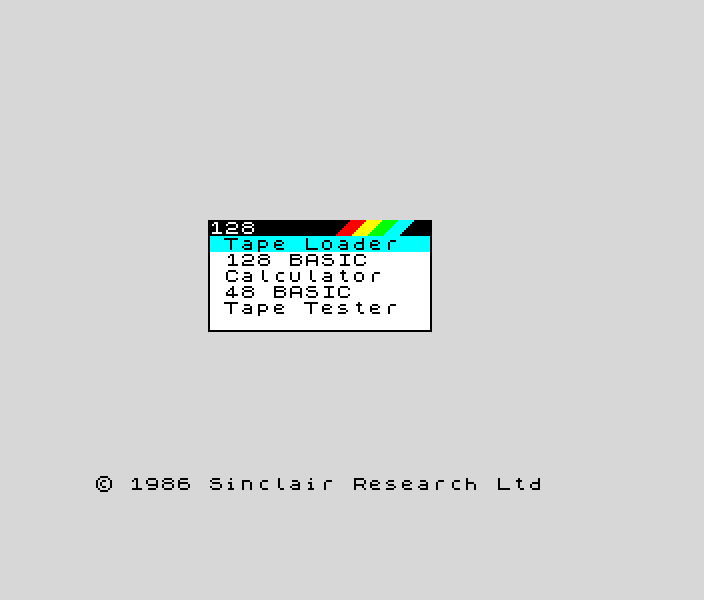
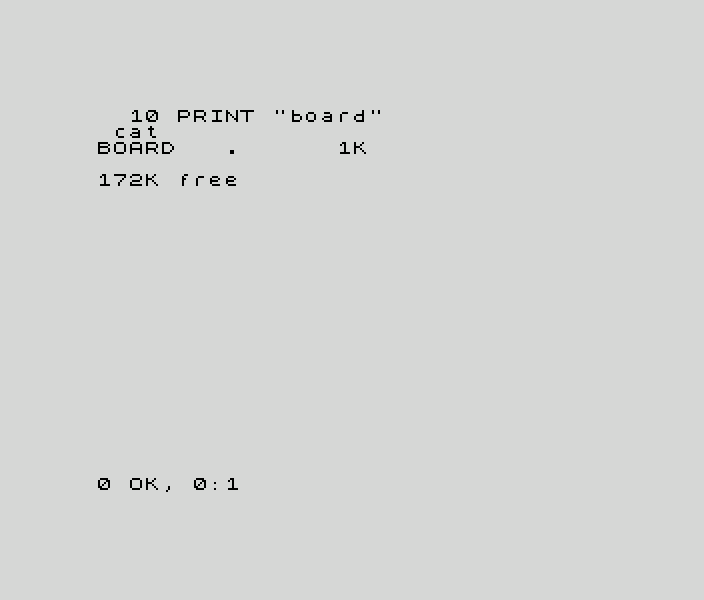
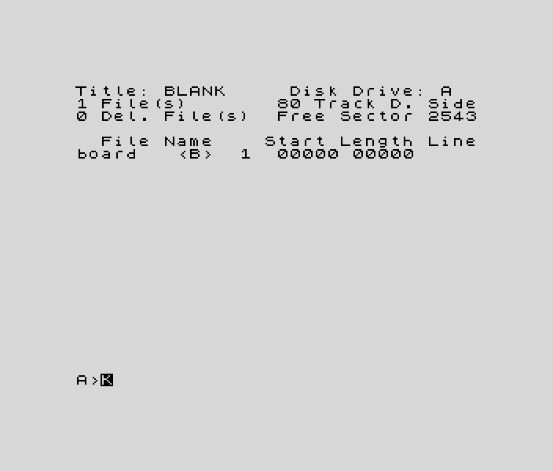
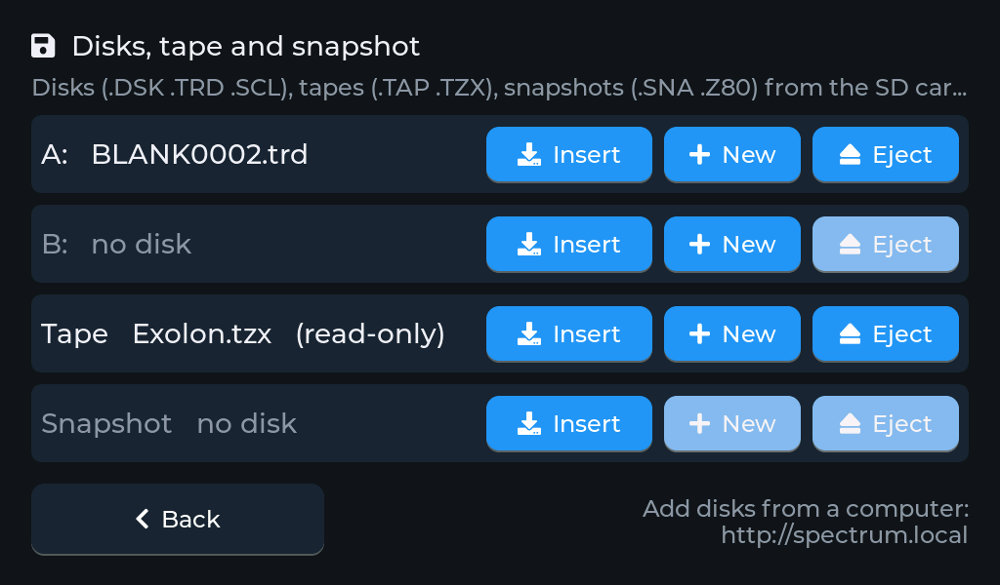
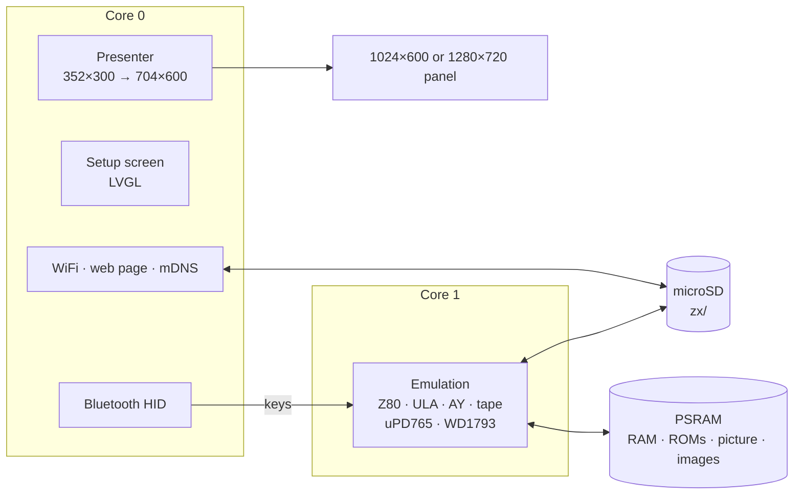

<h1 align="center">esp32zx</h1>

<p align="center">
  <b>A ZX Spectrum 128K, +2 or +3 on a 7-inch ESP32-S3 touch-screen board or an M5Stack Tab5.</b><br>
  Z80 with the ULA's contention, AY sound, tapes that load at once, the +3's disks and a Beta 128 (TR-DOS) on the 128K and +2, Bluetooth keyboard.
</p>

<p align="center">
  
  
  
  
  
  
</p>

<p align="center">
  
  
  <br>
  
  <br>
  <sub>The Spectrum 128's start-up menu, a program saved and catalogued on a new +3 disk, and TR-DOS on
  the 128K with a Beta 128 and a new disk. Screenshots from the board, border included; every
  pixel is shown twice in each direction on the panel.</sub>
</p>

esp32zx turns the Makerfabs MaTouch ESP32-S3 Parallel TFT with Touch 7", or an
M5Stack Tab5, into a ZX Spectrum. The picture, border included, fills the panel's height;
a Bluetooth keyboard works the Spectrum, and tapes, disks and snapshots come
from the microSD card. A setup screen on the touch panel, and a web page on
your network, handle everything else.

It's the sibling of [esp32ste](https://github.com/rlucencic/esp32ste) (Atari
STE), [esp32mac](https://github.com/rlucencic/esp32mac) (Macintosh Plus,
SE, Classic), [esp32cpc](https://github.com/rlucencic/esp32cpc) (Amstrad
CPC), [esp32cbm](https://github.com/rlucencic/esp32cbm) (Commodore 64 and
128) and [esp32xl](https://github.com/rlucencic/esp32xl) (Atari 800XL and
130XE); all six are built on the shared runtime
[esp32emu](https://github.com/rlucencic/esp32emu), which also holds the Z80
core this one shares with the CPC and the C128.

## Features

**The machine**
- **Three models**, chosen on the setup screen: the Sinclair ZX Spectrum 128,
  the Amstrad +2 (grey) and the +3, each with its own ROMs and 128 KB
- 128 BASIC, 48 BASIC, +3 BASIC and +3DOS, TR-DOS, from the original ROMs
- Z80 that passes zexall, in T-states with the ULA's memory and I/O
  contention (128K and +3 patterns), 50 Hz interrupt; border colour changes
  land on the right pixel, paper lines are drawn as the beam reaches them
- 128K paging (`$7FFD`) and the +3's all-RAM modes (`$1FFD`), shadow screen
- AY-3-8912 and the beeper, mixed on the speaker (and the tape's sound)
- Kempston, Sinclair or cursor joystick on the numeric keypad

**Tapes**
- **`.TAP` and `.TZX`** (standard, turbo, pure tone, pulses, pure data,
  direct recording, generalized data, pauses, loops, jumps)
- **Fast loading**: standard blocks load at once through the ROM's loader;
  turbo and custom loaders play in real time, started when a loader reads
  the tape (and loaders built on the ROM's edge loop run about twice as fast)
- `SAVE` writes into an inserted `.TAP`; a new empty tape is one tap away
- Protected tapes load: Speedlock 2 and 4, Hewson's loaders and others

**Disks**
- **+3**: its own uPD765 with `.DSK` images (standard and extended,
  esp32emu's controller, shared with the CPC), drives A: and B:
- **128K and +2**: a **Beta 128** interface (WD1793, TR-DOS 5.04T) with
  `.TRD` images and `.SCL` archives (read-only), drives A: and B:; a disk in
  A: boots TR-DOS
- **New blank disks**, formatted for the model: 640 KB TR-DOS or 173 KB +3
- Disk writes go back to the SD card a second after they happen

**Snapshots**
- **`.SNA`** (48K and 128K) and **`.Z80`** (versions 1 to 3, compressed or
  not); a 48K snapshot runs in 48K mode

**Around it**
- **Setup screen** before the Spectrum starts, and any time while it runs
  (hold the top-right corner for 2 seconds): WiFi, Bluetooth pairing,
  model, tape speed, drives, reset
- **Bluetooth keyboard** (BLE HID), with the Spectrum's shifted keys where
  a PC keyboard has them (cursor keys, Backspace, Esc for BREAK,
  punctuation through SYMBOL SHIFT)
- **Web page** at `http://spectrum.local`: drop tapes, disks, snapshots or
  `.ZIP` files onto it, put them into drives, eject, make blank disks and
  tapes, and watch the Spectrum, drives, board and Bluetooth devices live
- **Sound** on the board's speaker (optional, `menuconfig`)

<p align="center">
  
  <br><sub>The setup screen's drives page on the board</sub>
</p>

## Hardware

| | Makerfabs MaTouch ESP32-S3 7" | M5Stack Tab5 |
|---|---|---|
| Chip | ESP32-S3-WROOM-1-N16R8: 16 MB flash, 8 MB octal PSRAM | ESP32-P4 (RISC-V, 360 MHz): 16 MB flash, 32 MB PSRAM; an ESP32-C6 for WiFi and Bluetooth |
| Screen | 7" 1024×600 RGB, GT911 capacitive touch | 5" 1280×720 MIPI-DSI, capacitive touch, held landscape |
| Storage | microSD card (FAT32 or exFAT) | microSD card (FAT32 or exFAT) |
| Input | any BLE keyboard | any BLE keyboard, or the Tab5 Keyboard |
| Sound | a speaker on the MAX98357A output (optional, `menuconfig`) | the built-in speaker (ES8388) |

The Spectrum's picture is 352×300: the 256×192 screen with 48 pixels of
border left and right and 54 lines above and below. Every pixel is shown
twice in each direction, so it fills the panel's height as 704×600 (on the
Tab5 2.4 times: 844×720).

## Getting started

### 1. What you need

- [ESP-IDF](https://github.com/espressif/esp-idf) v5.5 (developed with v5.5.4)
- [esp32emu](https://github.com/rlucencic/esp32emu), checked out next to this project (`../esp32emu`)
- The Spectrum ROM images in `roms/` (see [roms/README.md](roms/README.md))
- A microSD card, FAT32 or exFAT

### 2. Build and flash

```sh
git clone https://github.com/rlucencic/esp32emu.git     # the shared runtime, next to it
git clone https://github.com/rlucencic/esp32zx.git && cd esp32zx
idf.py build
idf.py -p /dev/cu.usbmodem… flash      # app and the ROM images

# or for the M5Stack Tab5 (its own build folder and settings):
idf.py -B build-tab5 -DIDF_TARGET=esp32p4 -DSDKCONFIG=build-tab5/sdkconfig build
idf.py -B build-tab5 -DIDF_TARGET=esp32p4 -DSDKCONFIG=build-tab5/sdkconfig -p /dev/cu.usbmodem… flash
```

Later updates only need `idf.py -p … app-flash`. Instead of flashing the
ROMs, you can also copy them into a `roms` folder on the SD card.

### 3. First start

1. The board starts on the **setup screen**. Tap **WiFi** to join your
   network: the clock is set from the internet, and the web page becomes
   reachable.
2. Tap **Bluetooth** to pair a keyboard.
3. Choose the **model**, then tap **Start**.
4. Open `http://spectrum.local` and drop a tape onto the page, then
   **Insert into… → Tape**, and choose **Tape Loader** on the Spectrum (or
   `LOAD ""`).

## Using it

| To | Do |
|---|---|
| Get back to the setup screen | Hold the top-right corner of the screen for 2 s |
| Change the model or the tape speed | On the setup screen; **Restart** applies it |
| Load a tape | Insert it into **Tape**, then **Tape Loader** in the menu, or `LOAD ""` |
| Save to tape | Insert a `.TAP` (**New** makes an empty one), then `SAVE "name"` |
| Use a +3 disk | Insert the `.DSK` into **A:** on the +3: **Loader** in the menu boots it; `CAT`, `LOAD "name"` |
| Use a TR-DOS disk | Insert the `.TRD`/`.SCL` into **A:** on the 128K or +2 and reset: TR-DOS starts (`RUN` runs its boot file, `LIST` shows the catalogue); from BASIC, `RANDOMIZE USR 15616` |
| Load a snapshot | Insert the `.SNA`/`.Z80` into **Snapshot**: it starts at once (and again when the Spectrum is restarted) |
| Copy files from a computer | Drop them onto the web page (ZIP files are unpacked), or `curl -T game.tzx http://spectrum.local/disks/` |

Tapes, disks and snapshots live in the `zx` folder on the SD card. The
inserted ones are remembered across restarts.

**Keyboard**: letters, digits, Enter and Space as on the Spectrum; Shift is
CAPS SHIFT, Ctrl and Alt are SYMBOL SHIFT. Backspace is DELETE, the cursor
keys are CAPS SHIFT + 5–8, Esc is BREAK, Caps Lock is CAPS LOCK, Tab is
EXTEND MODE. Punctuation keys type their character (`;` is SYMBOL SHIFT + O,
and so on). F9 starts or stops the tape, F10 rewinds it.

**Joystick**: the numeric keypad (8 4 6 2 and the diagonals, 5 or 0 fire).
F11 switches it between Kempston, Sinclair (keys 6–0) and cursor (5–8, 0);
F12 makes the cursor keys the joystick as well, with Alt as fire.

## Configuration

`idf.py menuconfig` → **Emulator board**:

| Option | Default | |
|---|---|---|
| WiFi, setup screen | on | Time zone for the clock (POSIX TZ) |
| Start by itself | off | Countdown on the setup screen |
| Web page, network name | on, `spectrum` | `http://<name>.local` |
| BLE keyboard and mouse | on | |
| Sound on the speaker | off | Volume; moves the console to the UART port |

## How it works



- **`components/zx`**: the Spectrum, platform independent. It also builds on
  a desktop (`components/zx/host`) for testing with scripted typing, keys
  and joystick, tapes, disks and snapshots, screenshots, sound recording and
  CPU traces.
- **`main`**: the Spectrum on the board: memory, ROMs, settings, keyboard
  map, drives and status.
- **[esp32emu](https://github.com/rlucencic/esp32emu)**: the board runtime,
  the Z80 core (in T-states with the ULA's contention here) and the uPD765
  floppy controller, shared with [esp32cpc](https://github.com/rlucencic/esp32cpc).

A frame is 70,908 T-states (311 lines of 228). Each memory access to a
contended bank waits as long as the ULA's pattern says for that T-state;
I/O to the ULA's ports waits too (128K and +2). Paper lines are drawn from
memory as the beam reaches them, border changes are kept with their times
and drawn to the T-state at the end of the frame, and only lines that
changed are drawn again.

## Development

```sh
make -C components/zx/host                                      # desktop build of the Spectrum
ZX_TAPE=game.tzx components/zx/host/build/zx_host 128 3000 out.ppm
make -C ../esp32emu/components/z80/test                         # the Z80 exerciser
../esp32emu/components/z80/test/build/z80_test zexall.cim

python ../esp32emu/tools/emu_console.py /dev/cu.usbmodem… lcd screen.png        # screenshot of the panel
python ../esp32emu/tools/emu_console.py /dev/cu.usbmodem… send 'T 10 print 1\n' # type on the Spectrum
curl http://spectrum.local/api/status                                           # live status as JSON
```

`CLAUDE.md` has the details: architecture, timing, the tape player and its
traps, debugging options and the lessons learned along the way.

## Limitations

- The M5Stack Tab5 port is new: the machine starts there and runs at full
  speed at its start-up screen, with core 1 far less busy than on the S3,
  but sound, touch, Bluetooth and the Tab5 Keyboard have not been tried on
  it by hand yet.
- No 48K or 16K model (48K software runs in 48 BASIC or from 48K
  snapshots), no Pentagon or other clones, no Interface 1, Microdrive or
  printer.
- Contention is per memory access, without the internal cycles between
  them: multicolour engines that count every T-state may be a little off.
  Changes to the screen within a line show from the next line.
- The floppy controllers have no rotation timing (the WD1793's index pulse
  aside): disk protections that measure it fail. `.SCL` is read-only.
- No `.STX`/`.CSW` tapes; TZX CSW blocks are skipped.

## Credits

- [Fuse](https://fuse-emulator.sourceforge.net/) and libspectrum, the
  [World of Spectrum](https://worldofspectrum.org) technical pages and the
  TZX specification: the references for how the Spectrum, its tapes and the
  Beta 128 behave
- The zexdoc/zexall Z80 exercisers by Frank Cringle
- [LVGL](https://lvgl.io) for the setup screen
- [ESP-IDF](https://github.com/espressif/esp-idf) and NimBLE

## Licence

[MIT](LICENSE). LVGL (MIT) and ESP-IDF (Apache 2.0) are fetched at build time
and keep their own licences.

Sinclair, ZX Spectrum and Amstrad are trademarks of their owners. The ROM
images are not part of this repository.
